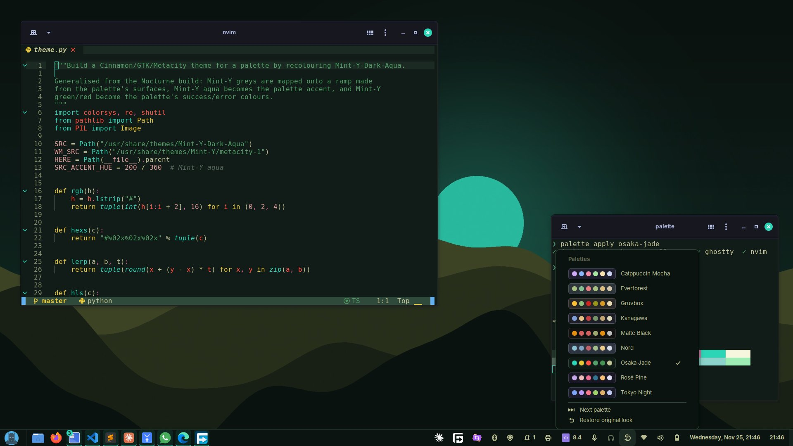
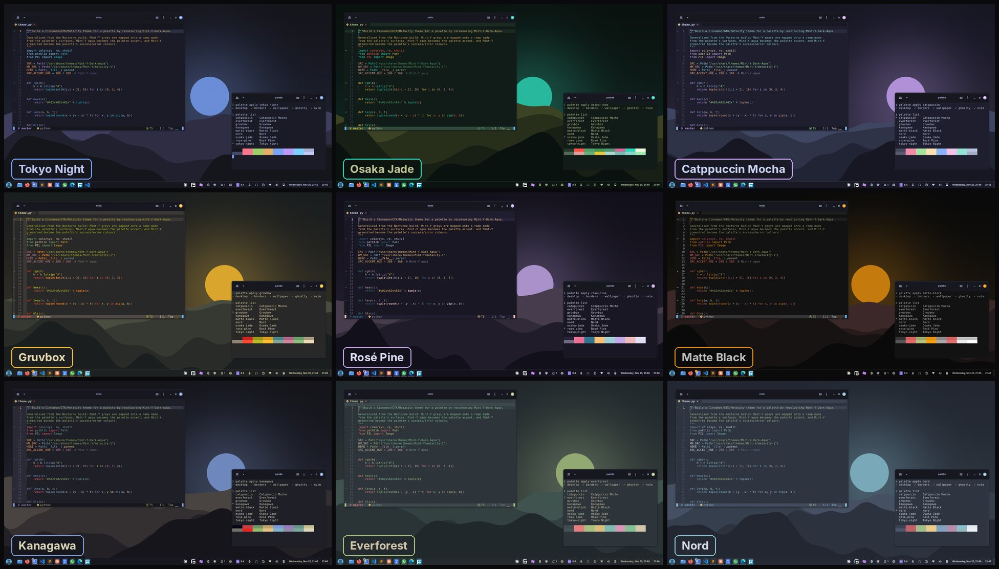

# cinnamon-palettes

Omarchy-style theme switching for Linux Mint Cinnamon. One click (or `palette apply <slug>`)
switches the whole desktop to a palette:

| Target | What changes |
|---|---|
| Cinnamon / GTK3 / GTK4 / window borders | `~/.themes/Palette-<Name>`, recoloured from Mint-Y-Dark with an Omarchy-flavoured overlay (flat surfaces, thin outlines, accent highlights) |
| Window borders | Rounded Corners extension (if installed): focused border = accent, unfocused = outline, applied live |
| libadwaita apps | `~/.config/gtk-4.0` symlink is repointed (only if it already is a symlink) |
| Wallpaper | a freely licensed photo per palette from Wikimedia Commons, downloaded on first use (credits below); or a generated one (dusk sky, accent sun, ridges) via `palette wallpaper generated` or the applet switch |
| Ghostty | `~/.config/ghostty/themes/palette-current`, live-reloaded with SIGUSR2 |
| btop | `~/.config/btop/themes/palette.theme` (picked up on next start) |
| Neovim (AstroNvim) | `colorscheme palette`; running instances recolour live over their RPC sockets |

Palettes: Tokyo Night, Catppuccin Mocha, Kanagawa, Everforest, Gruvbox, Nord, Rosé Pine,
Osaka Jade, Matte Black. Neovim uses the upstream colourscheme where one exists and
base16-nvim generated from the palette otherwise.

## Install

    ./install.sh

Then add the **Palettes** applet to a panel. Hotkey: <kbd>Super</kbd>+<kbd>Ctrl</kbd>+<kbd>Shift</kbd>+<kbd>Space</kbd>
opens the picker (a "next palette" hotkey can be set in the applet settings).

## CLI

    palette list | current | apply SLUG | next | prev | build [SLUG|--all] | restore
    palette wallpaper [photo|generated] | fetch

The first `apply` snapshots your current themes, wallpaper, Ghostty config, btop theme and
Neovim scheme to `~/.local/state/cinnamon-palettes/snapshot.json`; `palette restore` puts them back.

## Adding a palette

Drop a JSON file in `palettes/` (copy an existing one): surfaces `bg_dark`, `bg`, `bg_alt`,
`outline`, text `fg`, `fg_dim`, `accent`, `accent2`, 16 `ansi` colours, optional
`success`/`error`/`warning`, and `nvim` (`{plugin, colorscheme}` or `{base16: true}`).
Themes rebuild automatically when the palette or build files change.

## Credits

### Wallpaper photos

Not stored in this repo: each is downloaded from Wikimedia Commons the first time its palette is applied.

| Palette | Photo | Author | Licence |
|---|---|---|---|
| Catppuccin Mocha | [Clear Night (227774827)](https://commons.wikimedia.org/wiki/File:Clear_Night_(227774827).jpeg) | Alexandre Patrier | [CC BY 3.0](https://creativecommons.org/licenses/by/3.0) |
| Everforest | [Dülmen, Rorup, NSG Roruper Holz -- 2021 -- 8187-91](https://commons.wikimedia.org/wiki/File:D%C3%BClmen,_Rorup,_NSG_Roruper_Holz_--_2021_--_8187-91.jpg) | Dietmar Rabich | [CC BY-SA 4.0](https://creativecommons.org/licenses/by-sa/4.0) |
| Gruvbox | [Dülmen, Börnste, Waldweg -- 2015 -- 4649](https://commons.wikimedia.org/wiki/File:D%C3%BClmen,_B%C3%B6rnste,_Waldweg_--_2015_--_4649.jpg) | Dietmar Rabich | [CC BY-SA 4.0](https://creativecommons.org/licenses/by-sa/4.0) |
| Kanagawa | [Great Wave off Kanagawa2](https://commons.wikimedia.org/wiki/File:Great_Wave_off_Kanagawa2.jpg) | After Katsushika Hokusai | Public domain |
| Matte Black | [Black sand in Waihi Beach Reserve 06](https://commons.wikimedia.org/wiki/File:Black_sand_in_Waihi_Beach_Reserve_06.jpg) | Krzysztof Golik | [CC BY-SA 4.0](https://creativecommons.org/licenses/by-sa/4.0) |
| Nord | [Sildpollneset](https://commons.wikimedia.org/wiki/File:Sildpollneset.jpg) | Øystein Bjørke | [CC BY-SA 3.0](https://creativecommons.org/licenses/by-sa/3.0) |
| Osaka Jade | [Bamboo Forest, Arashiyama, Kyoto, Japan](https://commons.wikimedia.org/wiki/File:Bamboo_Forest,_Arashiyama,_Kyoto,_Japan.jpg) | Basile Morin | [CC BY-SA 4.0](https://creativecommons.org/licenses/by-sa/4.0) |
| Rosé Pine | [Lake Sylvester during the sunrise, Kahurangi, New Zealand](https://commons.wikimedia.org/wiki/File:Lake_Sylvester_during_the_sunrise,_Kahurangi,_New_Zealand.jpg) | Michal Klajban | [CC BY-SA 4.0](https://creativecommons.org/licenses/by-sa/4.0) |
| Tokyo Night | [Minato City, Tokyo, Japan (Night)-denoised](https://commons.wikimedia.org/wiki/File:Minato_City,_Tokyo,_Japan_(Night)-denoised.jpg) | David Kernan | [CC BY 4.0](https://creativecommons.org/licenses/by/4.0) |

Palettes from their upstream projects (Tokyo Night, Catppuccin, Kanagawa, Everforest, Gruvbox,
Nord, Rosé Pine) and Omarchy (Osaka Jade, Matte Black). Themes derive from Mint-Y; GPL-3.0-or-later.
